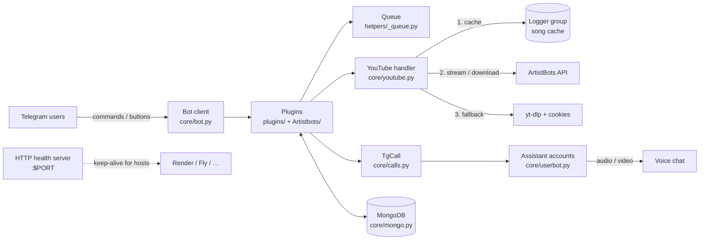
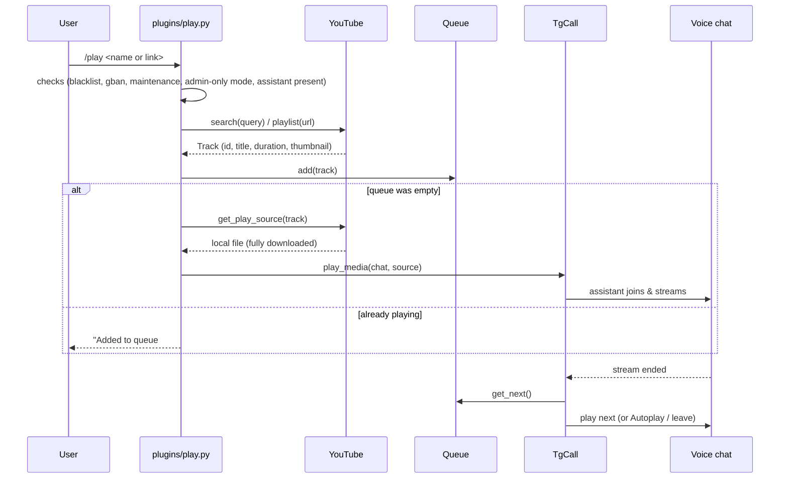
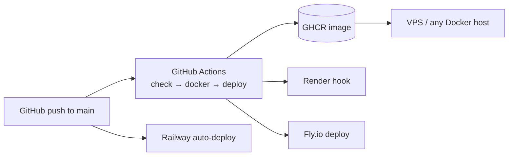

<div align="center">

# 🏗️ Architecture

How **ArtistMusic** works inside.
Made by **Artist** · [@elevenyts](https://github.com/elevenyts) · [ArtistBots](https://t.me/Artistbots)

</div>

> For *where files are*, see [Structure.md](Structure.md). This document explains *how the pieces fit together*.

---

## 1. Big picture

ArtistMusic is a single async Python process. It runs a **bot account** (talks to users) and one to three **assistant accounts** (join voice chats and stream audio/video). Songs come from the **ArtistBots API**, with a yt-dlp + cookies fallback. **MongoDB** stores settings, and a private **logger group** doubles as a song cache.



| Piece | Role |
|---|---|
| **Bot** (`BOT_TOKEN`) | Receives commands, sends messages, buttons, thumbnails |
| **Assistant(s)** (`STRING_SESSION`, `2`, `3`) | Real user accounts that join the voice chat and play the stream |
| **py-tgcalls** | Streams media into the voice chat (uses FFmpeg) |
| **ArtistBots API** | Resolves a YouTube ID to a stream URL / file |
| **MongoDB** | Persistent settings and caches |
| **Logger group** (`LOGGER_ID`) | Receives logs and stores uploaded songs as a file cache |

---

## 2. Startup sequence

Entry point: `bash start` → `python3 -m ArtistMusic` → `ArtistMusic/__main__.py`.

1. **Import `ArtistMusic/__init__.py`** — sets up logging (`log.txt`, rotating 10 MB × 5), loads `Config`, validates it (`config.check()`), then creates the shared singletons in this order:
   `app` (Bot) → dirs → `userbot` → `db` → `lang` → `tg` / `yt` → `preload` → `queue` → `tune` (TgCall).
2. **Validate env** — missing required variables stop the bot with a clear message.
3. **Health server** — a tiny HTTP server starts in a thread on `$PORT` (default `8000`) and answers `Bot is running`. Web-service hosts (Render, etc.) need this to see the app as alive.
4. `db.connect()` — connect to MongoDB.
5. `app.boot()` — start the bot client.
6. `userbot.boot()` — start the assistant clients. The assistants also auto-join the ArtistBots community chats (see `core/userbot.py`).
7. `tune.boot()` — start py-tgcalls for each assistant and register call handlers.
8. **Load plugins** — every module in `plugins/` and `Artistbots/` is imported (discovered with `Path.rglob("*.py")`). Registering a handler is just importing the file.
9. Set the Telegram **command menu** (`BOT_COMMANDS` in `__main__.py`).
10. Load **sudoers** and **blacklisted users** from MongoDB into the in-memory filters.
11. `idle()` — run until stopped; then `stop()` cancels background tasks and closes the bot, assistants and database.

---

## 3. Core components

### `Bot` — `core/bot.py`
A `pyrogram.Client` (kurigram) with HTML parse mode. Holds `owner`, `sudoers`, `sudo_filter` and `bl_users`. The last two are *mutable* filters, so adding a sudo user or blacklisting someone takes effect immediately without a restart.

### `Userbot` — `core/userbot.py`
Up to three assistant clients (`one`, `two`, `three`), created only for the session strings you set. More assistants means more groups can be served in parallel; `MongoDB.set_assistant()` assigns each chat to one assistant and remembers it.

### `TgCall` — `core/calls.py`
Extends `PyTgCalls`. Responsible for `play_media`, `pause`, `resume`, `seek_stream`, `replay`, `play_next`, `stop` and the end-of-stream / kicked-from-call handlers. When a track ends, `play_next()` takes the next item from the queue (or asks Autoplay for a related track), sends the new now-playing message and starts preloading.

### `YouTube` — `core/youtube.py`
Search (py-yt-search), URL/playlist parsing, and getting a playable source. See section 4.

### `MongoDB` — `core/mongo.py`
Async PyMongo client (database name `ArtistMusic`). Most reads are served from **in-memory caches** (admin lists, auth, chats, language, play mode, gbans, blacklist) and written through to the database. Main collections:

| Collection | Stores |
|---|---|
| `chats`, `users` | Chats and users the bot has seen (for broadcast, stats) |
| `auth` | Authorized (non-admin) users per chat |
| `assistant` | Which assistant serves which chat |
| `lang`, `userlang` | Chat language and personal language |
| `play`, `forcemode` | Admin-only play mode / force mode per chat |
| `song_cache`, `cache` | Song → logger-group file reference; misc cache |

Global flags (maintenance, logger on/off, video-play on/off, gban list, blacklist) are also kept here.

### `Language` — `core/lang.py`
Loads `locales/*.json` for every code listed in `lang_codes`. `get_merged_lang()` copies English first and overlays the chosen language, so **missing keys fall back to English**. A user's personal language wins over the chat language. The `@lang.language()` decorator puts the dictionary on `message.lang`.

### `Queue` — `helpers/_queue.py`
Per-chat in-memory list of `MediaItem`s: `add`, `force_add` (play now), `get_current`, `get_next`, `peek_next`, `remove_current`, `clear`. Limit comes from `QUEUE_LIMIT`.

### `Preload` — `helpers/_preload.py`, `core/preload.py`
While a song plays, the next one or two tracks are downloaded in the background so the switch is instant.
> Note: `ArtistMusic/__init__.py` creates `preload` twice; the second one (`helpers/_preload.py`) replaces the first, so that is the one in use.

### `Autoplay` — `core/autoplay.py`
When the queue is empty and autoplay is on for the chat, it finds a related track based on what just played and queues it.

### Thumbnails — `helpers/_thumbnails.py`
Pillow draws the now-playing image (cover, title, dominant-colour accent, fonts from `helpers/fonts/`). Controlled by `THUMB_GEN`.

---

## 4. How a song is played



### Source priority (`YouTube.get_play_source`)

1. **Local cache** — file already in `downloads/`.
2. **Logger-group cache** — `song_cache` collection points to a file the bot uploaded earlier; it is fetched from Telegram instead of re-downloading.
3. **ArtistBots API `/download`** — full download first, then play.
4. **yt-dlp + cookies fallback** (when `ENABLE_COOKIES_FALLBACK=True` and `COOKIE_URL` is set).
5. Live streams skip the cache and go straight to the live path.

After a fresh download the file is uploaded to the logger group in the background so the next request is a cache hit.

**Protections:** identical simultaneous downloads share one task (`_inflight` dedupe); at most 5 downloads run at once (semaphore); corrupted or empty files are detected and purged before use; search results are cached for 10 minutes.

---

## 5. Request handling & permissions

Handlers are plain Pyrogram decorators. Typical stack:

```python
@app.on_message(filters.command(["skip"]) & filters.group & ~app.bl_users)
@lang.language()          # adds message.lang
@can_manage_vc            # admin / authorized user / admin-only mode checks
async def skip_handler(_, m): ...
```

| Level | How it is enforced |
|---|---|
| Everyone | not in `app.bl_users` (blacklist) and not gbanned |
| Group admin / authorized user | `helpers/_admins.py` — `admin_check`, `can_manage_vc`; admin list cached and refreshable with `/reload` |
| Sudo | `app.sudo_filter` — broadcast, gban, blacklist, maintenance, … |
| Owner | `filters.user(app.owner)` — `/eval`, `/exec`, plus everything above |
| Group owner / sudo | Mass actions (`/kickall`, `/banall`, …) check chat ownership (or sudo) and ask for Yes/No confirmation |

A low-priority handler in `plugins/misc.py` (`group=-1`) runs before everything else and blocks commands while **maintenance mode** is on.

---

## 6. Group-manager layer (`Artistbots/`)

Independent of the music engine. Each file registers its own commands and only needs the Bot client and the permission helpers. Notable behaviours:

- **Tagging** — 6 hidden emoji mentions per message; on `FloodWait` it waits, resends the **same** batch (nobody is skipped), then slows down.
- **Welcome card / text images** — `_textimg.py` renders names with large Unicode fonts so any script displays correctly; welcome cards can be animated (needs FFmpeg).
- **VC log** — watches voice-chat participants and posts join/leave/removed alerts, queued per chat and de-duplicated.
- **Stickers** — `/kang` copies a whole pack, `/sticker` builds a pack from one sticker, titled `<Name> by Artistbots`.

---

## 7. Configuration

All settings live in `config.py` and are read from environment variables (via `python-dotenv`, so a local `.env` works). `Artist.env` is the template. Groups of settings:

| Group | Variables |
|---|---|
| Telegram | `API_ID`, `API_HASH`, `BOT_TOKEN`, `OWNER_ID`, `LOGGER_ID`, `STRING_SESSION`, `STRING_SESSION2`, `STRING_SESSION3` |
| Database | `MONGO_DB_URI` |
| Limits | `DURATION_LIMIT` (minutes), `QUEUE_LIMIT`, `PLAYLIST_LIMIT` |
| API & download | `ARTISTBOTS_API_URL`, `ARTISTBOTS_KEY`, `ENABLE_API`, `ENABLE_COOKIES_FALLBACK`, `COOKIE_URL`, `API_TIMEOUT`, `API_STREAM_TIMEOUT` |
| Features | `AUTO_END`, `AUTO_LEAVE`, `THUMB_GEN`, `VIDEO_PLAY`, `VIDEO_MAX_HEIGHT` |
| Branding | `SUPPORT_CHANNEL`, `SUPPORT_CHAT`, `START_IMG`, `PING_IMG`, `RADIO_IMG`, `DEFAULT_THUMB` |
| Moderation | `EXCLUDED_CHATS`, `EXCLUDED_USERNAMES` |

---

## 8. Deployment model



- One **Dockerfile** (Python 3.10 slim + FFmpeg + Node.js + git) is used by every platform, so FFmpeg is always present.
- The container runs `bash start`. State lives in MongoDB and Telegram, so the container is **stateless** and can be restarted or moved freely (the local `downloads/` cache is just a speed-up).
- Run **one instance per bot token**. Two copies of the same bot/session will fight each other.
- Platform files: `render.yaml`, `railway.json`, `fly.toml`, `heroku.yml` + `app.json`, `docker-compose.yml`, `Procfile`. Details in [DEPLOY.md](DEPLOY.md).

---

## 9. Concurrency & performance notes

- Everything is `asyncio`; one event loop serves all groups.
- `__main__.py` raises the Linux open-file limit (up to 65536) because every stream and FFmpeg probe uses file descriptors.
- Pyrogram `max_concurrent_transmissions=7`; MongoDB pool 5–20 connections.
- In-memory caches for admins, auth, language and chats keep database reads off the hot path.
- Preloading, stream-first playback and the logger-group cache all exist to cut the time between `/play` and sound.

---

## 10. Extending the bot

- **New command** → add a file to `plugins/` or `Artistbots/`; it loads automatically. See [CONTRIBUTING.md](CONTRIBUTING.md#adding-a-plugin).
- **New language** → add a JSON file and register it in `lang_codes`.
- **New download source** → implement it next to `download_via_api` / `download_via_cookies` in `core/youtube.py` and add it to the priority chain in `_download_impl`.
- **New setting** → add it to `Config` in `config.py`, to `Artist.env`, and to the tables in `README.md` and here.

---

<div align="center">

Made with ❤️ by **Artist** · Powered by **ArtistBots**
[GitHub](https://github.com/elevenyts) · [Channel](https://t.me/Artistbots) · [Support](https://t.me/Elevenytschats)

</div>
